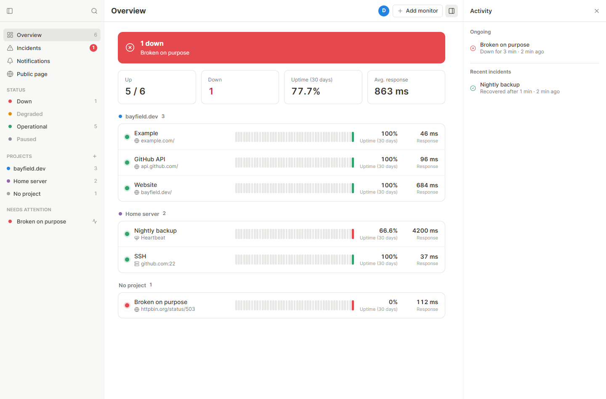
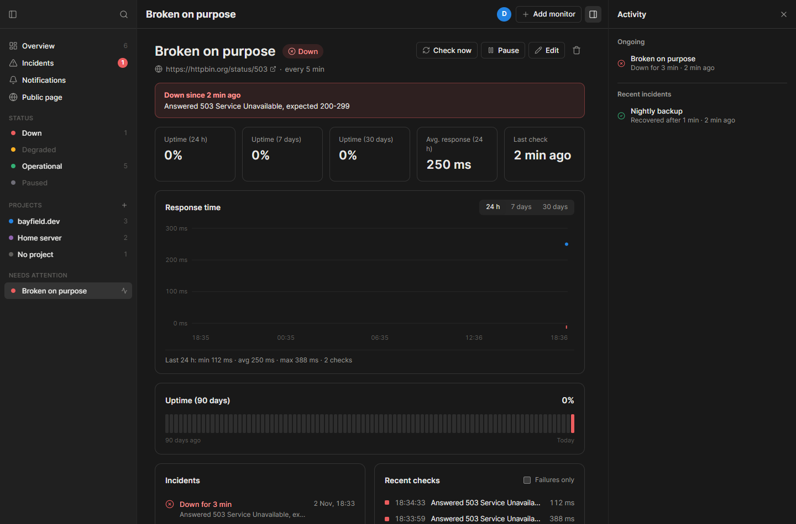
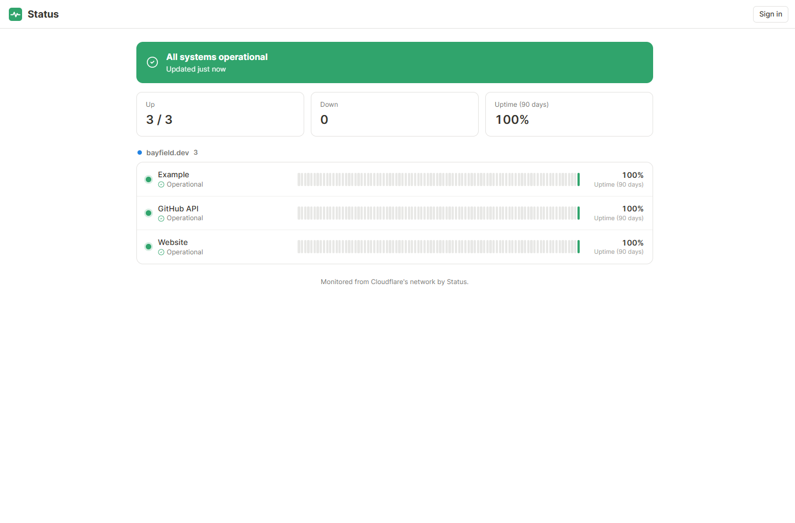
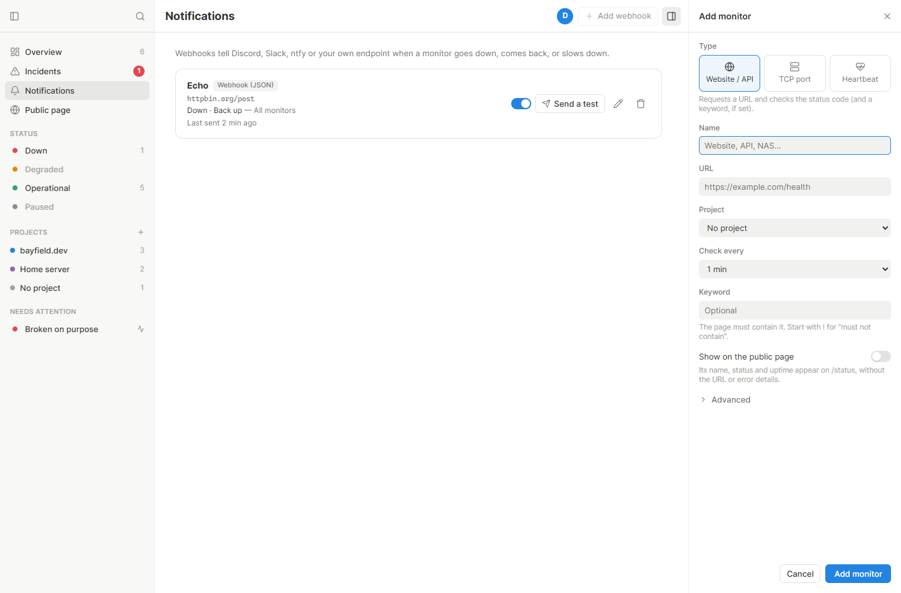
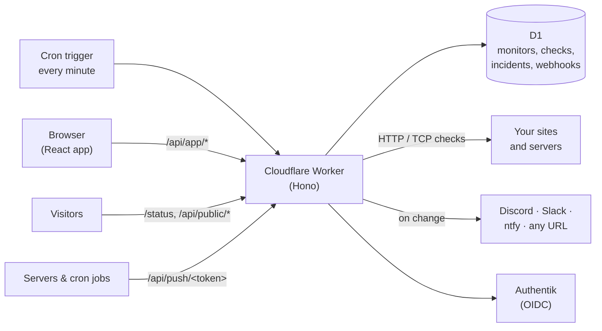

<div align="center">
  

  # Status

  **Uptime monitoring and public status pages for every project and server, running on Cloudflare Workers, with webhook alerts and Authentik single sign-on.**

  [](#️--disclaimer)
  [](LICENSE)
  [](https://react.dev)
  [](https://workers.cloudflare.com)
  [](https://developers.cloudflare.com/d1/)
  [](https://status.bayfield.dev)

  <br />
  <br />

  
</div>


## ⚠️ • Disclaimer

This is a personal project built for my own use, not a polished product: expect missing pieces, sharp edges, and breaking changes.


## 📋 • Table of Contents

- [📖 • Overview](#--overview)
- [📸 • Screenshots](#--screenshots)
- [🧩 • Components](#--components)
- [🛠️ • Tech Stack](#️--tech-stack)
- [🚀 • Getting Started](#--getting-started)
  - [Prerequisites](#prerequisites)
  - [Installation](#installation)
  - [Environment Variables](#environment-variables)
  - [Running Locally](#running-locally)
- [🔔 • Webhooks](#--webhooks)
- [💓 • Heartbeats](#--heartbeats)
- [🔐 • Sign-in & Security](#--sign-in--security)
- [⌨️ • Keyboard Shortcuts](#️--keyboard-shortcuts)
- [❤️ • Health Check](#️--health-check)
- [📁 • Project Structure](#--project-structure)
- [☁️ • Cloudflare Deployment](#️--cloudflare-deployment)
- [🙌 • Credits](#--credits)
- [📄 • License](#--license)


## 📖 • Overview

Status watches my sites, APIs and servers from Cloudflare's network, so it keeps working when the machines it watches don't. It runs as one Cloudflare Worker: a cron trigger checks what's due every minute, D1 keeps the history, and the same Worker serves the dashboard and the public status pages. The UI is built like my other apps ([Calendar](https://github.com/PaulBayfield/calendar.bayfield.dev), [Notes](https://github.com/PaulBayfield/notes.bayfield.dev), [Llip](https://github.com/PaulBayfield/llip.bayfield.dev)): same header, sidebar, side panel, settings and update check.

Key features:
- **Three kinds of monitors:**
  - **Website / API:** a request to a URL, with the expected status codes (`200-299,301`), an optional keyword (or `!keyword` for "must not contain"), method, headers, timeout and redirects
  - **TCP port:** SSH, a database, a game server… anything that accepts connections
  - **Heartbeat:** your server or cron job calls a secret URL; no call in time means down. Works for machines behind NAT or a firewall, and for backups and scheduled jobs
- **Fewer false alarms:** a monitor only counts as down after N failed checks in a row (2 by default), and can be marked **degraded** when it answers slower than a threshold
- **Projects:** group monitors by site, app or server, each with a colour; filter the overview by project or status
- **Overview:** an overall banner (all operational / N down), tiles (up, down, 30-day uptime, average response), and every monitor with its last 45 days of bars, uptime and response time
- **Monitor page:** uptime over 24 h, 7, 30 and 90 days, a response time chart (24 h / 7 / 30 days, with failures marked along the baseline), the 90-day bars, its incidents and recent checks. Check now, pause, edit, delete
- **Incidents:** opened when a monitor goes down, closed when it's back, with the cause and how long it lasted
- **Webhook notifications** to Discord, Slack, ntfy or any URL (signed JSON), on down / back up / degraded, for all monitors or chosen projects, with a "Send a test" button
- **Status pages**, like Uptime Kuma's: as many as you like, each at its own address (`/status/croustillant`) with a title, a description, an optional logo (a link to an image hosted elsewhere) and named groups of monitors in the order you choose (or one group per project in a click). One is the default page, also shown at `/status` and at `/` to visitors. Visitors see names, status, 90-day bars and the last week's incidents, never URLs or error details. Plus shields-style badges at `/api/public/badge/<id>` for monitors shown on a page
- **The shared shell:** collapsible, resizable sidebar; activity side panel; command palette (`Ctrl+K`); settings with 5 themes (System, Light, Dark, Rosé Pine, Rosé Pine Dawn); English and French; update check in **Settings → About**; phone layout


## 📸 • Screenshots

| | |
|---|---|
|  |  |
|  |  |


## 🧩 • Components



| Part | Where | What |
|---|---|---|
| Web app | `src/` | React 19 + Vite: the dashboard and the public status pages |
| Worker | `server/src/index.ts` | Routes, security headers, static assets, the `scheduled` handler |
| Checks | `server/src/checks.ts` | HTTP, TCP and heartbeat probes, state changes, incidents, housekeeping |
| Notifications | `server/src/notify.ts` | Webhook payloads for each service, HMAC signing |
| API | `server/src/api.ts` | Monitors, projects, incidents, webhooks, account, users |
| Status pages | `server/src/pages.ts` | Status pages and their groups (`/api/app/pages`), and what visitors get of them |
| Public | `server/src/public.ts` | Status page data, badges, heartbeat pings (cached at the edge for a minute, cleared when a page is edited) |
| Database | `server/src/db.ts` | D1 helpers and the schema migrations, applied on first request |


## 🛠️ • Tech Stack

| Layer | Choice |
|---|---|
| Front end | React 19, TypeScript 7, Vite 8 |
| Server | [Hono](https://hono.dev) 4 on [Cloudflare Workers](https://workers.cloudflare.com) |
| Database | [Cloudflare D1](https://developers.cloudflare.com/d1/) (SQLite) |
| Scheduling | [Cron Triggers](https://developers.cloudflare.com/workers/configuration/cron-triggers/) |
| TCP checks | [`cloudflare:sockets`](https://developers.cloudflare.com/workers/runtime-apis/tcp-sockets/) |
| Sign-in | OIDC (authorization code + PKCE) with Authentik |
| Icons | [Lucide](https://lucide.dev) paths |

> Unlike its siblings, Status doesn't run in Docker next to Postgres: a monitor should live away from what it monitors, so it runs on Cloudflare. The shell and conventions are the same.


## 🚀 • Getting Started

### Prerequisites

- Node.js 24+
- A Cloudflare account (the free plan works for a handful of monitors; see [limits](#️--cloudflare-deployment))
- An OIDC provider (Authentik) for production; local development can sign in without one

### Installation

```sh
git clone https://github.com/PaulBayfield/status.bayfield.dev.git
cd status.bayfield.dev
npm install && npm --prefix server install
```

### Environment Variables

Plain options go in `server/wrangler.jsonc` → `vars`, secrets through `npx wrangler secret put NAME`. Locally, `server/.dev.vars` holds both (copy `server/.dev.vars.example`).

| Variable | Default | Description |
|---|---|---|
| `PUBLIC_URL` | (required) | Where Status is reachable: OIDC redirect, links in notifications |
| `OIDC_ISSUER` | (required) | The provider's issuer, e.g. `https://auth.example.com/application/o/status/` |
| `OIDC_CLIENT_ID` | (required) | |
| `OIDC_CLIENT_SECRET` | (required, **secret**) | |
| `OIDC_NAME` | `Authentik` | Shown on the sign-in button |
| `OIDC_AUTO_CREATE` | `true` | Create accounts on first sign-in |
| `OIDC_ALLOWED_GROUPS` | | Only these groups may sign in |
| `OIDC_ADMIN_GROUPS` | | Members are admins, checked at every sign-in |
| `OIDC_DEFAULT_ROLE` | `viewer` | Role of new accounts: `viewer` or `collaborator` (the very first account is an admin) |
| `DEV_LOGIN_USER` | | Local only: sign in as this user without a provider (ignored unless `PUBLIC_URL` is localhost) |
| `SESSION_IDLE_DAYS` | `30` | |
| `RETENTION_DAYS` | `30` | Days of raw checks kept (charts, 24 h uptime). Daily summaries are kept a year |
| `UPDATE_CHECK` | `true` | Look for new releases on GitHub (Settings → About) |

### Running Locally

```sh
cp server/.dev.vars.example server/.dev.vars   # DEV_LOGIN_USER=demo is already set
npm run server                                 # the Worker on :8820, with a local D1 (wrangler dev)
npm run dev                                    # the web app on :1460, proxying /api
```

Open <http://localhost:1460> and use **Development sign-in**. Optional demo data, once the first request has created the schema:

```sh
npm --prefix server run seed
```

Checks run when the cron fires; locally, trigger it by hand:

```sh
curl "http://localhost:8820/__scheduled?cron=*+*+*+*+*"
```


## 🔔 • Webhooks

Add them on the **Notifications** page. Each one picks its events (down, back up, degraded) and its projects (or all monitors).

| Service | URL | Notes |
|---|---|---|
| Discord | Channel → Integrations → Webhooks | A [components](https://discord.com/developers/docs/components/overview) message: a container in the event's colour with the title and text, an optional thumbnail, the details, link buttons and a footer |
| Slack | Incoming Webhooks | A short message with the details and links |
| ntfy | `https://ntfy.sh/<topic>` or your own server | Title, tags, priority 5 when down, view buttons; optional access token |
| Webhook (JSON) | Any HTTPS URL | See below |

### Customising the messages

Each webhook's **Message** button opens an editor with a live preview (a Discord look-alike for Discord, the raw payload for the others) and a **Send a test** for each event. Everything is per webhook:

- **Texts:** a title and a text for each event (down, back up, back to normal, degraded), with placeholders: `{monitor}`, `{project}`, `{target}`, `{status}`, `{previous}`, `{cause}`, `{code}`, `{latency}`, `{duration}`, `{time}`, `{year}`, `{link}`, `{page}`. Empty fields use the defaults of the chosen language (English or French). Discord markdown works in Discord messages.
- **Details** listed under the text (target, cause, response time, downtime, project, time) and **buttons** (the monitor in Status, and a status page: the monitor's own, or one you pick), with their labels.
- **Discord:** a mention per event (`<@&role id>`, `<@user id>`, `@here`, `@everyone`; nothing else in a message can ping), the webhook's name and avatar, a thumbnail, the footer, the status emoji and the three colours.

Discord only accepts link buttons to public `https://` addresses, so they're left out while Status runs on localhost.

The JSON webhook POSTs (`title`, `message`, `details` and `buttons` come from the webhook's message template):

```json
{
  "event": "down",
  "title": "API is down",
  "message": "Answered 503 Service Unavailable, expected 200-299",
  "url": "https://status.bayfield.dev/m/3",
  "at": "2026-11-02T17:33:59.161Z",
  "from": "up",
  "to": "down",
  "downSince": null,
  "monitor": { "id": 3, "name": "API", "type": "http", "target": "https://api.example.com/health", "projectId": 1 },
  "check": { "status": "down", "latency": 112, "code": 503, "message": "…" },
  "details": [{ "label": "Target", "value": "https://api.example.com/health" }],
  "buttons": [{ "label": "Open in Status", "url": "https://status.bayfield.dev/m/3" }]
}
```

With a signing secret, each request carries `X-Status-Signature: sha256=<hex HMAC-SHA256 of the raw body>`, and always `X-Status-Event`.


## 💓 • Heartbeats

A heartbeat monitor gets a secret push URL (shown on its page). Call it at least once per interval:

```sh
# crontab: back up, then report in
0 3 * * *  /usr/local/bin/backup && curl -fsS -m 10 --retry 3 https://status.bayfield.dev/api/push/<token> > /dev/null
```

- `?status=down&msg=Disk%20full` reports a failure right away
- `&ms=4200` records how long the job took (charted like a response time)
- No call within the interval plus a minute's grace: down


## 🔐 • Sign-in & Security

- Sign-in only through your OIDC provider (authorization code + PKCE, state and nonce checked); no passwords in Status
- Session cookies are random tokens (`HttpOnly`, `SameSite=Lax`, `__Host-` over HTTPS); only their SHA-256 is stored
- Cookie-authenticated writes must come from the app's own origin
- A strict Content Security Policy: only the app's own origin, plus the one inline theme script by hash
- Roles: **viewers** see everything, **collaborators** manage monitors, projects and webhooks, **admins** also manage users
- Status pages and badges only show the monitors placed on a status page, without targets or error messages
- Webhook secrets are write-only (never sent back to the page); URLs are shortened in the list


## ⌨️ • Keyboard Shortcuts

| Keys | Action |
|---|---|
| `Ctrl+K` or `/` | Search |
| `N` | Add a monitor |
| `E` | Edit the open monitor |
| `R` | Check the open monitor now |
| `G` | Go to the overview |
| `Ctrl+B` or `\` | Toggle the sidebar |
| `.` | Toggle the side panel |
| `Ctrl+,` | Settings |
| `Esc` | Close, cancel |


## ❤️ • Health Check

`GET /api/health` answers `{"ok":true}` once D1 responds. Point another monitor at it (Status can't tell you it's down itself).


## 📁 • Project Structure

```
status.bayfield.dev/
├── .github/workflows/      # ci.yml (build + check), deployment.yaml (wrangler deploy + release)
├── src/                    # React app
│   ├── components/         # shell (Sidebar, Toolbar, SidePanel, SettingsDialog, SearchDialog…) + pages
│   ├── lib/                # api, app context, router, i18n, settings, updates, hooks
│   ├── styles.css          # the shared shell stylesheet
│   └── status.css          # status colours, bars, chart, monitor rows, status pages
├── server/
│   ├── src/                # the Worker: index, config, db, auth, checks, notify, api, public, views…
│   ├── scripts/            # seed.sql (demo data), ensure-dist.ts
│   ├── wrangler.jsonc      # Worker, D1, cron, route, vars
│   └── .dev.vars.example   # every option, documented
├── public/  docs/
└── index.html  vite.config.ts  package.json
```


## ☁️ • Cloudflare Deployment

1. **Create the database** and paste its id into `server/wrangler.jsonc`:
   ```sh
   cd server && npx wrangler login && npx wrangler d1 create status
   ```
2. **Configure:** set `PUBLIC_URL`, `OIDC_ISSUER`, `OIDC_CLIENT_ID` (and the rest) under `vars`, then the secret:
   ```sh
   npx wrangler secret put OIDC_CLIENT_SECRET
   ```
   In Authentik, the redirect URI is `https://status.bayfield.dev/api/auth/oidc/callback`.
3. **Deploy** from the project root: `npm run deploy` (builds the web app, then `wrangler deploy`). The `routes` entry serves it on `status.bayfield.dev` as a custom domain (the zone must be on the same account). The schema is created on the first request.
4. **Automatic deploys:** add the `CLOUDFLARE_API_TOKEN` and `CLOUDFLARE_ACCOUNT_ID` repository secrets; every push to `main` deploys and publishes a release when the version changes.

Limits to know:
- **Plan:** each check writes three rows (the check, the day's summary, the monitor). The free plan's 100,000 rows written a day fits about 10 monitors at a 1-minute interval (more at longer intervals); Workers Paid ($5/month) covers hundreds
- **Per run:** up to 30 checks per minute, 6 at a time (the Workers connection limit, so queued requests don't skew timings). More due monitors wait for the next minute
- **TCP checks** can't reach hosts behind Cloudflare's proxy (use the origin's address) or port 25
- **One location:** checks come from wherever Cloudflare runs the cron, not several regions


## 🙌 • Credits

Made by [Paul Bayfield](https://github.com/PaulBayfield).

| Dependency | Use |
|---|---|
| [React](https://react.dev) | UI |
| [Vite](https://vite.dev) | Build |
| [Hono](https://hono.dev) | Worker routing |
| [Wrangler](https://developers.cloudflare.com/workers/wrangler/) | Local dev and deploys |
| [Lucide](https://lucide.dev) | Icons |


## 📄 • License

This project is licensed under the GNU Affero General Public License v3.0: see [LICENSE](LICENSE).

```
Status: uptime monitoring and a public status page.
Copyright (C) 2026 Paul Bayfield

This program is free software: you can redistribute it and/or modify
it under the terms of the GNU Affero General Public License as published
by the Free Software Foundation, either version 3 of the License, or
(at your option) any later version.

This program is distributed in the hope that it will be useful,
but WITHOUT ANY WARRANTY; without even the implied warranty of
MERCHANTABILITY or FITNESS FOR A PARTICULAR PURPOSE.  See the
GNU Affero General Public License for more details.

You should have received a copy of the GNU Affero General Public License
along with this program.  If not, see <https://www.gnu.org/licenses/>.
```
